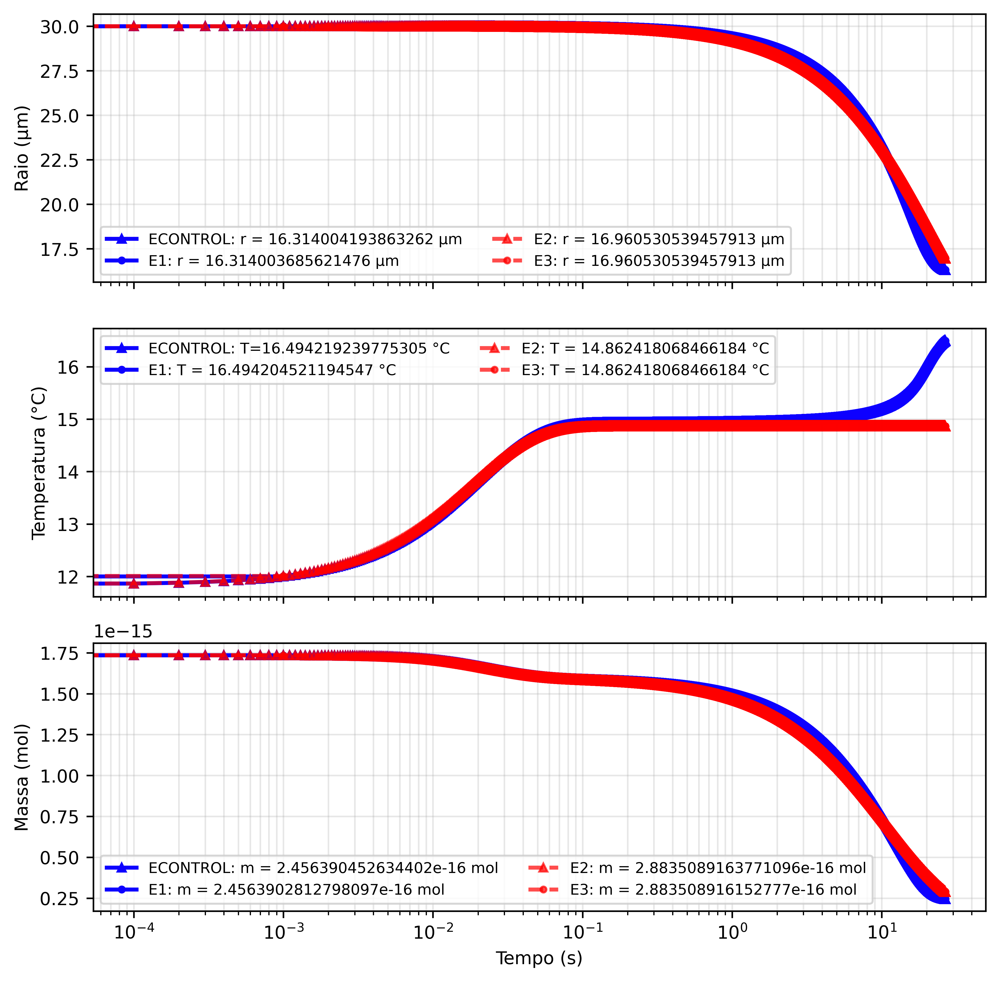
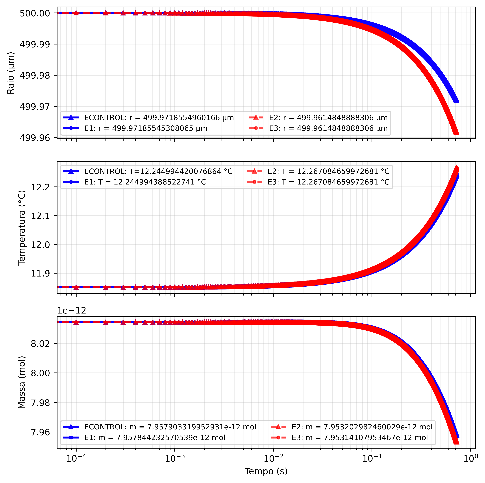

# IC2: Aplicação do método de Runge-Kutta com controle por subpassos em uma equação de difusão de massa em superfície esférica

Iniciação Científica · UFES · Edital Piic 2025/2026 · Orientador: Iury Angelo Gonçalves · Aluno: Emanuel Pinto Sampaio

Relatório final: [PDF](relatorio/Emanuel_relatório_final_2026_IC2.pdf) · Etapa anterior: [IC1](https://github.com/emanuelpintosampaio/IC1)

## Resumo

Simulação da absorção de CO₂ por gotículas de espuma marinha resolvendo o **sistema completo** de equações para o raio r(t), a temperatura T(t) e a massa m(t), com o método de **Runge-Kutta de 3ª ordem (SSPRK3)**. Como a temperatura muda muito mais rápido que o raio e a massa, usamos **controle por subpassos**: a temperatura avança 10 passos pequenos para cada passo do raio e da massa. O modelo completo é comparado com o modelo simplificado da IC1, para gotículas de 30 e 500 µm:

| ECONTROL | E1 | E2 | E3 |
|---|---|---|---|
| completo, passo fixo | completo, subpassos | simplificado, passo fixo | simplificado, subpassos |

## Rodar no Google Colab

Abra um notebook em [colab.research.google.com](https://colab.research.google.com/), cole numa célula e execute:

```python
%cd /content
![ -d IC2 ] || git clone -q https://github.com/emanuelpintosampaio/IC2.git
%cd IC2/codigos
%run menu_colab.py
```

O menu pede o raio da gota (30 ou 500 µm) e o experimento (ECONTROL, E1, E2, E3 ou todos juntos) e mostra os gráficos.

## Resultados

Modelo completo (azul) × modelo simplificado (vermelho), para 30 µm (esquerda) e 500 µm (direita):

| 30 µm | 500 µm |
|---|---|
|  |  |

Tempo de execução para 30 µm: ECONTROL 8,98 s · E1 5,76 s · E2 3,36 s · E3 0,62 s.

## Conclusão

Para gotículas grandes, o modelo simplificado reduz o tempo de execução sem perder muita precisão. Para gotículas pequenas, o acoplamento entre raio, temperatura e massa torna o modelo simplificado inadequado, e o **E1 (sistema completo com subpassos)** é a melhor opção: mantém a precisão do modelo completo com custo menor. A paralelização com MPI não trouxe ganho, porque os dois processos precisam trocar dados a cada passo; seria mais eficiente que cada processo simulasse uma gotícula diferente.

## Arquivos

- `codigos/`: scripts usados no relatório (`IC2_completo_*` e `IC2_simplificacao_*`, para 30 e 500 µm), a versão com MPI e os módulos físicos. Em `codigos/desenvolvimento/` estão as versões feitas ao longo do projeto.
- `referencia_tcc/`: os mesmos experimentos no código do TCC, com os **parâmetros corretos** (de referência).
- `figuras_relatorio/`: figuras e tabelas do relatório.
- `relatorio/`: relatório final em PDF.
