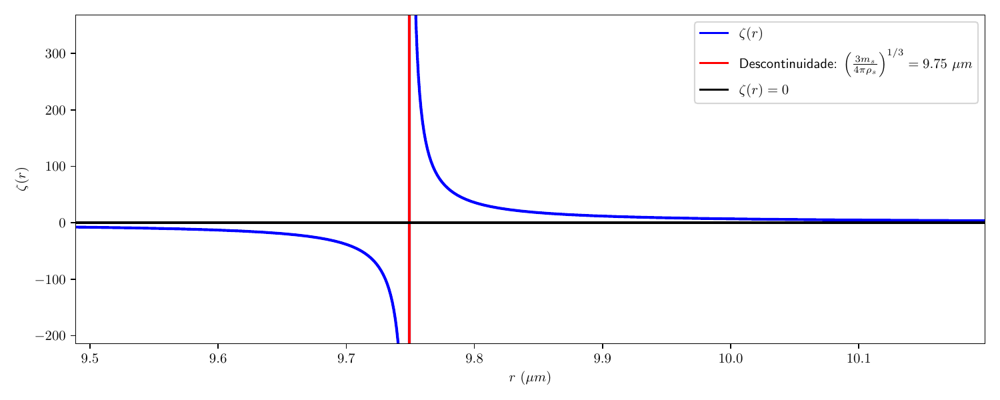
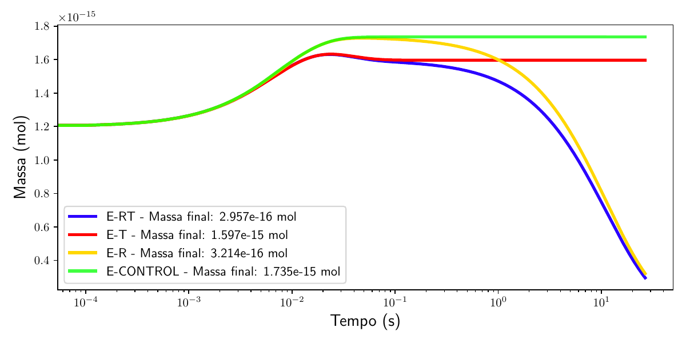
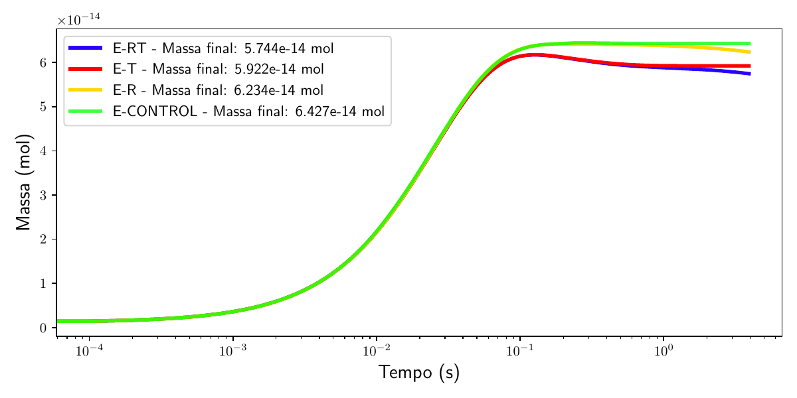
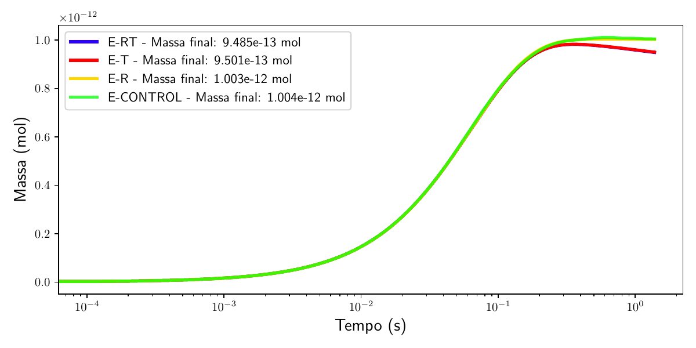
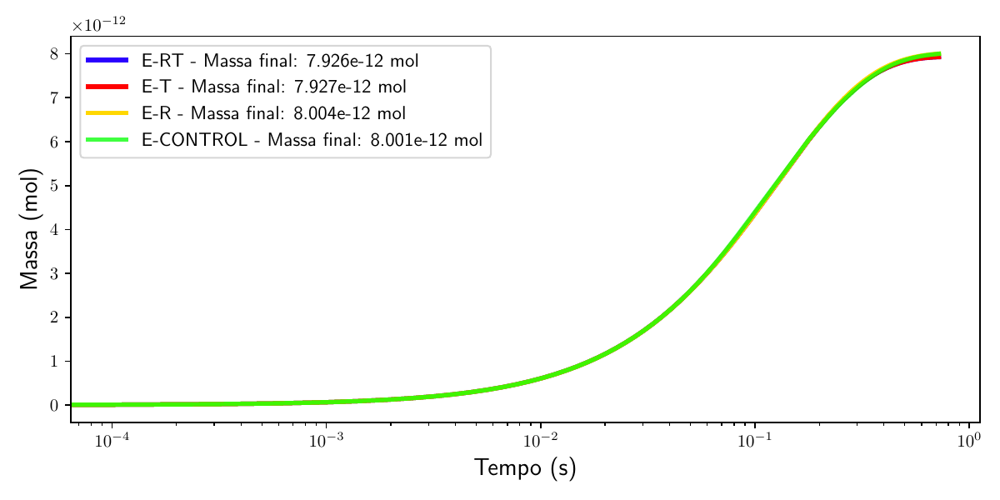

# IC1: Métodos matemáticos para resolver uma equação de difusão de massa em superfície esférica

Edital Piic 2024/2025 · UFES · Orientador: Iury Angelo Gonçalves · Estudante: Emanuel Pinto Sampaio

Relatório final: [`relatorio/Emanuel_relatório_final_2026_IC1.pdf`](relatorio/Emanuel_relatório_final_2026_IC1.pdf)

## O que foi feito

Difusão de CO₂ através da superfície de uma gotícula de espuma marinha (Pruppacher & Klett, Eq. 17-126). O raio e a temperatura da gotícula seguem as soluções analíticas de decaimento exponencial de Andreas (1989, 2005):

```
r(t) = r_eq + (r_i − r_eq)·exp(−t/τ_r)        T(t) = T_eq + (T_i − T_eq)·exp(−t/τ_T)
```

A massa de CO₂ m(t) é integrada pelo método de **Euler Backward (Euler implícito)** até o tempo de vida da gotícula, τ_f = H_s / (2 U_f). Com r e T constantes, a equação também é resolvida analiticamente pelo **método do fator integrante**. A velocidade terminal U_f e o raio de equilíbrio r_eq (raiz de ζ(r)) são calculados pelo **método de Newton**.

| Experimento | r(t) | T(t) |
|---|---|---|
| E-CONTROL | constante | constante |
| E-R | varia | constante |
| E-T | constante | varia |
| E-RT | varia | varia |

Parâmetros do relatório: T_a = 290 K, T_mar = 285 K, S = 34 psu, f = 0,8, C_ar = 0,0154 mol/m³, H_s = 6 m; r_i = 30, 100, 250 e 500 µm.

> A versão de referência, com os parâmetros corretos (T_ar = 18 °C, T_mar = 293,15 K, T_gota = 19,8 °C, f = 0,9 e Φ_s com `M_H2O`), é a do TCC: veja [`../ic2/referencia_tcc/`](../ic2/referencia_tcc/) e o repositório [emanuelpintosampaio/TCC](https://github.com/emanuelpintosampaio/TCC).

## Gráficos do relatório

**Figura 2: função ζ(r)**, cuja raiz é o raio de equilíbrio r_eq



**Figura 3: massa de CO₂ nos quatro experimentos (H_s = 6 m)**

| (a) r_i = 30 µm | (b) r_i = 100 µm |
|---|---|
|  |  |
| **(c) r_i = 250 µm** | **(d) r_i = 500 µm** |
|  |  |

Os PDFs originais estão em [`figuras_relatorio/`](figuras_relatorio/), junto com outros gráficos da IC1 que não entraram no relatório: `reqnew.pdf` e `reqnew2.pdf` (outras versões de ζ(r)), `reqnewton.pdf` (iterações do método de Newton, r_eq = 11,51 µm) e `Figure_1.pdf` (m(t) com r e T constantes).

## Códigos (`codigos/`)

| Arquivo | Seção do relatório | O que faz |
|---|---|---|
| `main_code.py` | 4.3 e 4.4 | Menu com os experimentos: 1 = E-RT, 2 = E-R, 3 = E-T (Euler Backward) e 4 = E-CONTROL (EDO com r e T constantes) |
| `2)-EULER_IMPLICITO(BACKWARD)_SIMPLIFICAÇÕES.py` | 4.3 e 4.4 | Roda os quatro experimentos por Euler Backward e imprime a massa final de cada um |
| `GRAFICO/graph_metd_euler.py` | 4.3 e 4.4 | E-RT, E-R e E-T por Euler Backward com as constantes já calculadas (r_eq, τ_r, T_eq, τ_T), com gráficos de m(t), r(t) e T(t) |
| `euler_backward_r.py` | 4.3 | Primeiro teste do Euler Backward com r(t) variando |
| `edo_fator_integrante.py` | Eqs. 36 a 45 | Solução analítica com r e T constantes (fator integrante) |
| `edo_python.py` | Eqs. 36 a 45 | A mesma EDO com r e T constantes resolvida pelo `odeint`, para conferir a solução analítica |
| `tau_f.py` | 4.1.1 | Velocidade terminal U_f (Newton) e tempo de vida τ_f |
| `graph_req.py` | 4.1.4, Figura 2 | Gráfico de ζ(r) e do raio de equilíbrio |
| `NEWTON/`, `T_EQ/`, `TAU_R/`, `TAU_T/`, `DGH/`, `U_f/`, `CONSTANTES` | 4.1 e 4.2 | Módulos: método de Newton, T_eq, τ_r, τ_T, D_g* e H*, velocidade terminal e constantes |

## Como rodar

```bash
pip install numpy matplotlib scipy
cd ic1/codigos
python tau_f.py                                             # τ_f (menos de 1 s)
python "2)-EULER_IMPLICITO(BACKWARD)_SIMPLIFICAÇÕES.py"     # os quatro experimentos
python main_code.py                                         # menu interativo
python GRAFICO/graph_metd_euler.py                          # menu interativo com gráficos
```

## Observações

- **O script que desenhou a Figura 3 não foi encontrado** (nem nas pastas do computador nem no histórico do editor). O mais próximo é o `2)-EULER_IMPLICITO(BACKWARD)_SIMPLIFICAÇÕES.py`, que calcula os mesmos quatro experimentos por Euler Backward. Com Δt = 10⁻⁵ s, ele reproduz os valores da figura com três algarismos em quase todos os casos; a maior diferença é em E-R e E-RT para 30 µm:

  | r_i | E-RT | E-T | E-R | E-CONTROL |
  |---|---|---|---|---|
  | 30 µm | 2,884e-16 (fig.: 2,957e-16) | 1,595e-15 (1,597e-15) | 3,136e-16 (3,214e-16) | 1,735e-15 ✓ |
  | 100 µm | 5,742e-14 (5,744e-14) | 5,921e-14 (5,922e-14) | 6,233e-14 (6,234e-14) | 6,427e-14 ✓ |
  | 250 µm | 9,484e-13 (9,485e-13) | 9,500e-13 (9,501e-13) | 1,003e-12 ✓ | 1,004e-12 ✓ |
  | 500 µm | 7,926e-12 ✓ | 7,927e-12 ✓ | 8,004e-12 ✓ | 8,006e-12 (8,001e-12) |

  No arquivo o passo está em Δt = 10⁻² s (`dts_test`); para 500 µm, cujo τ_f é de 0,72 s, esse passo é grosso e os valores se afastam um pouco mais.
- `graph_req.py` usa `text.usetex` e precisa de LaTeX instalado.
- Os scripts importam `from GRAFICO.DGH import ...`; a pasta `GRAFICO/DGH/` é uma cópia de `DGH/` para que eles funcionem sem alteração.
